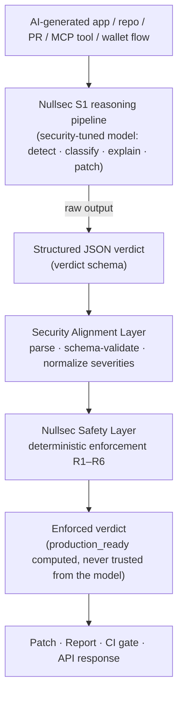

# Nullsec S1

**Security-native LLM system for AI-generated application security.**

[](#current-verified-state)
[](#current-verified-state)
[](#the-security-alignment-layer)
[](#current-verified-state)
[](pyproject.toml)
[](#license)

Nullsec S1 is being built to **analyze, explain, patch, and gate AI-generated applications before they reach production.**

It combines:

- a curated corpus of AI-generated application failures
- a specialized code-security model training pipeline
- structured JSON security verdicts
- a deterministic **Security Alignment Layer**
- secure patch generation
- CI / API / CLI enforcement
- a benchmark and release-validation framework

> **Current status — training-ready, corpus-complete, safety-layer-enforced. Not yet a trained model release.**
> The corpus has reached the v1.0 training threshold and the deterministic safety layer is fully enforced and tested. No GPU training run has happened yet, so there is no trained adapter and no real model benchmark. The repo enforces that distinction automatically (see [Current verified state](#current-verified-state)).

This is not a scanner. It is a full security system for AI-generated software — a learned reviewer wrapped in a non-bypassable, deterministic enforcement layer.

> **A note on names.** *Nullsec S1* is the system. Its reference implementation ships as the `nullsec1` Python package and CLI, and the model release identity is `Nullsec-1.0` (`python -m nullsec.core.version`). You will see all three; they refer to the same project.

---

## Table of contents

- [Architecture](#architecture)
- [Why Nullsec S1 exists](#why-nullsec-s1-exists)
- [What Nullsec S1 does](#what-nullsec-s1-does)
- [How S1 is different](#how-s1-is-different)
- [Core system components](#core-system-components)
- [Current verified state](#current-verified-state)
- [The Security Alignment Layer](#the-security-alignment-layer)
- [Quickstart](#quickstart)
- [Corpus status](#corpus-status)
- [Training workflow](#training-workflow)
- [Training on GPU](#training-on-gpu)
- [Benchmark workflow](#benchmark-workflow)
- [Release pipeline](#release-pipeline)
- [Repo structure](#repo-structure)
- [Roadmap](#roadmap)
- [What Nullsec S1 does not claim](#what-nullsec-s1-does-not-claim)
- [Contributing](#contributing)
- [Security](#security)
- [License](#license)

---

## Architecture

Nullsec S1 is a pipeline, not a single model call. A security-tuned model *proposes* a verdict; two deterministic layers *align and enforce* it before anything is trusted.



Plain-text view of the same flow:

```
AI-generated app / repo / PR / MCP tool / wallet flow
        │
        ▼
Nullsec S1 reasoning pipeline        (security-tuned model: detect · classify · explain · patch)
        │  raw output
        ▼
structured JSON verdict              (data/schemas/verdict.schema.json)
        │
        ▼
Security Alignment Layer             (parse · schema-validate · type-check · normalize severities)
        │  structurally-valid verdict
        ▼
Nullsec Safety Layer                 (deterministic enforcement: rules R1–R6, severity/risk flooring)
        │
        ▼
enforced verdict                     (production_ready recomputed, never trusted from the model)
        │
        ▼
patch · report · CI gate · API response
```

The model's own `production_ready` claim is **advisory only**. The Safety Layer recomputes it and allows `true` only when all **eight** check dimensions pass with no HIGH/CRITICAL finding:

`auth · secrets · input_validation · rate_limits · permissions · dangerous_exec · dependency_risk · environment_exposure`

Full design: [`docs/SYSTEM_OVERVIEW.md`](docs/SYSTEM_OVERVIEW.md) and [`docs/architecture/nullsec1_architecture.md`](docs/architecture/nullsec1_architecture.md).

---

## Why Nullsec S1 exists

AI tools generate software faster than humans can review it. **The bottleneck is no longer generation. The bottleneck is trust.**

Generated apps routinely ship with:

- broken or missing authentication
- exposed secrets and credentials
- unsafe admin routes
- missing rate limits
- insecure file uploads
- unsafe wallet approvals and unbounded transactions
- over-permissioned MCP tools
- prompt-injection-to-tool-execution paths
- environment / configuration exposure
- production paths nobody actually verified

A general code model can describe these problems in prose. What it cannot do is give you a **structured, schema-checked verdict** whose `production_ready` decision is **enforced deterministically** rather than asserted by a model that can be prompt-injected. That gap — between *opinion* and *enforced verdict* — is the reason Nullsec S1 exists.

---

## What Nullsec S1 does

Given source code (a file, a directory, a PR, an MCP tool definition, or a generated Web3 flow), Nullsec S1:

1. **Detects** vulnerabilities across a 16-category security taxonomy.
2. **Classifies** severity and confidence per finding.
3. **Explains** a concrete exploit scenario for each finding.
4. **Patches** — emits a secure patch target (unified diff or corrected snippet) per finding.
5. **Reports** on all eight check dimensions explicitly (`pass | fail | not_applicable | not_checked`).
6. **Gates** production-readiness through the deterministic Safety Layer, never the model alone.
7. **Enforces** in CI / API / CLI — the CLI exits non-zero when code is not production-ready, so it doubles as a build gate.

Output is always a single JSON object defined by [`data/schemas/verdict.schema.json`](data/schemas/verdict.schema.json), and it always passes through the same two deterministic layers — whether invoked through the server, the CLI, the benchmark suite, or the training data builder. There is exactly one enforcement path.

---

## How S1 is different

| Capability           | Nullsec S1                              | GPT / Claude / generic coding LLMs |
| -------------------- | --------------------------------------- | ---------------------------------- |
| Objective            | Security verdicts for AI-generated apps | General code generation/reasoning  |
| Corpus               | AI-generated app failure corpus         | Broad general-purpose data         |
| Output               | Structured JSON security verdicts       | Free-form responses                |
| Enforcement          | Deterministic Safety Layer              | User-defined prompting             |
| Production readiness | Built-in release gating                 | Manual interpretation              |
| MCP / tool abuse     | First-class category                    | General reasoning                  |
| Wallet / Web3 risk   | First-class category                    | General reasoning                  |
| Secure patches       | Security-native patch targets           | General code edits                 |
| Claim validation     | Built-in honesty checks                 | External / manual                  |

**Nullsec S1 is not trying to be better at everything.** It is being built to be better at one job: *verifying whether AI-generated software is safe to ship.* General-purpose models remain excellent at generation and broad reasoning; Nullsec S1 is the specialized, enforceable reviewer that sits in front of them.

---

## Core system components

| Path | What it is |
|------|------------|
| [`corpus/`](corpus/) | Curated training corpus — the single source of truth (`authored/` + opt-in `ingested/` + `synthetic/`). |
| [`taxonomy/`](taxonomy/) | The 16-category security taxonomy mapped to 8 check dimensions (`taxonomy.json`). |
| [`nullsec/safety/`](nullsec/safety/) | The Security Alignment Layer (`alignment.py`) + Nullsec Safety Layer (`enforcement.py`). |
| [`nullsec/core/`](nullsec/core/) | Reasoning pipeline (`engine.py`), verdict models, canonical prompts, version/fingerprint. |
| [`nullsec/ingest/`](nullsec/ingest/) | CVE/NVD, Semgrep, SARIF/CodeQL ingestion into the verdict contract. |
| [`training/`](training/) | Dataset prep, QLoRA training, corpus validation, release threshold, preflight. |
| [`benchmarks/`](benchmarks/) | Evaluation runners + adversarial Safety Layer probes. |
| [`scripts/validate_claims.py`](scripts/validate_claims.py) | Public claim validator — the honesty gate. |
| [`scripts/release_candidate.py`](scripts/release_candidate.py) | Release gate — builds a bundle only from real artifacts. |
| [`serving/`](serving/) | FastAPI serving layer (`/v1/model`, `/v1/analyze`, `/v1/patch`, streaming). |
| [`cli/`](cli/) | `nullsec1` command-line analyzer + CI gate. |
| [`reports/`](reports/) | Corpus curation sprint reports (auditable provenance). |
| [`docs/`](docs/) | Technical documentation (system overview, safety layer, corpus, roadmap, non-claims). |

---

## Current verified state

This snapshot reflects the artifacts on disk right now. Every number below is produced by a command in this repo — none are hand-entered. Run the commands in [Quickstart](#quickstart) to reproduce them.

| Fact | Value | Source command |
|------|-------|----------------|
| Curated corpus | **500** examples (63 hand-authored + 437 curated-ingested) | `training/dataset_stats.py --include-ingested` |
| Train / eval split | **400 train / 100 eval** (eval_frac 0.2, seed 42) | `training/prepare_dataset.py --include-ingested` |
| Taxonomy categories | **16** categories → 8 check dimensions | `taxonomy/taxonomy.json` |
| Per-category coverage | every category **≥ 30** curated (threshold requires ≥ 25) | `training/release_threshold.py --include-ingested` |
| Safety Layer consistency | **100%** (500 / 500) | `training/dataset_stats.py --include-ingested` |
| Adversarial safety probes | **8 / 8 blocked**, 0 bypassed | `python -m benchmarks.safety_probes` |
| Test suite | passing | `pytest -q` |
| Release threshold | **PASS** | `training/release_threshold.py --include-ingested` |

**What the claim validator currently permits** (`python scripts/validate_claims.py`):

- ✅ `training-ready` — pipeline, schema, and a non-empty curated corpus are present
- ✅ `safety-layer-enforced` — all adversarial Safety Layer probes are blocked
- ⛔ `trained model` — **forbidden**: no trained adapter exists yet
- ⛔ `benchmarked` — **forbidden**: no real model benchmark report exists yet
- ⛔ real-model evaluation — **forbidden**: no benchmark report from a live model run exists
- ⛔ `release candidate` — **forbidden**: requires a trained adapter, a real benchmark, probes, and a bundle
- ⛔ `production-ready` (the model) — **forbidden**: the highest bar, gated on all of the above
- ⛔ `first / only / best` — **never** auto-permitted from local artifacts

The honesty gate (`scripts/validate_claims.py --check`) scans this README and fails CI if it asserts anything the artifacts do not support. The wording here is written to pass that check truthfully.

---

## The Security Alignment Layer

The deterministic layer is the reason Nullsec S1 is a security *system* rather than a code model that emits opinions. It runs in two stages.

**Stage 1 — Security Alignment Layer** (`nullsec/safety/alignment.py`): extract the JSON object (tolerant of code fences, preamble, and trailing prose), validate it against the verdict schema, type-check it into the `Verdict` model, and normalize finding severities *up* to each category's taxonomy floor. Anything that cannot be aligned raises `VerdictParseError` instead of being guessed at.

**Stage 2 — Nullsec Safety Layer** (`nullsec/safety/enforcement.py`): take the structurally-valid verdict and deny `production_ready` if **any** of these hold:

| Rule | `production_ready` is denied when… |
|------|------------------------------------|
| R1 | any required dimension is `not_checked` |
| R2 | any required dimension is `fail` |
| R3 | any finding is HIGH or CRITICAL |
| R4 | `risk_score` exceeds the production threshold (default 20) |
| R5 | a finding contradicts a dimension reported as `pass` |
| R6 | overall severity is HIGH or CRITICAL |

It also **raises (never lowers)** severity and `risk_score` to match the worst finding, so the model cannot under-report. Because enforcement is deterministic and independent of the model, an attacker who manipulates the model — e.g. via prompt injection embedded in the code under review — still cannot obtain a false `production_ready: true`. This is verified by adversarial probes in [`benchmarks/safety_probes.py`](benchmarks/safety_probes.py), including a prompt-injection-in-prose probe.

Deep dive: [`docs/SECURITY_ALIGNMENT_LAYER.md`](docs/SECURITY_ALIGNMENT_LAYER.md).

---

## Quickstart

Local CPU machines can verify the corpus, the deterministic layers, and the safety probes — no GPU required.

```bash
python3.11 -m venv .venv
source .venv/bin/activate
python -m pip install --upgrade pip setuptools wheel
python -m pip install -e ".[dev]"

python training/prepare_dataset.py --include-ingested --out data/processed
pytest -q
python training/validate_corpus.py --include-ingested
python training/release_threshold.py --include-ingested
python scripts/validate_claims.py --check
```

Inspect model identity and the reproducible fingerprint at any time:

```bash
python -m nullsec.core.version
```

---

## Corpus status

`corpus/` is the single source of truth for training data. The current curated corpus is **500 examples** (63 hand-authored + 437 curated-ingested), every taxonomy category has **≥ 30** curated examples, and **Safety Layer consistency is 100%** — so the v1.0 training threshold (`training/release_threshold.py`) passes.

Provenance is tracked explicitly and never blurred:

- `hand_authored` — original examples written for this repo (counts as curated).
- `curated_ingested` — CVE / scanner / real-failure records that passed human review and source-provenance enforcement (counts as curated).
- `synthetic_variant` — labeled, structure-preserving augmentations; **never** counts toward curated thresholds.

Raw and rejected candidates are tracked separately and are never training-eligible. The curation workflow, schema, and provenance rules are documented in [`docs/CORPUS.md`](docs/CORPUS.md), with auditable sprint reports in [`reports/`](reports/).

---

## Training workflow

The training targets are built from the corpus through the **same** alignment + safety layers used at serving time, so no malformed or gate-inconsistent verdict ever enters training.

```bash
# 1. build chat-formatted train/eval JSONL from the curated corpus
python training/prepare_dataset.py --include-ingested --out data/processed

# 2. confirm the corpus is genuinely v1.0-ready (exits non-zero until it is)
python training/release_threshold.py --include-ingested

# 3. (on a GPU box) preflight, then train the QLoRA adapter
python training/preflight_train.py
python training/train_qlora.py --config training/config.yaml
```

The default config targets a **single 24GB GPU** (e.g. RTX 3090/4090) with 4-bit NF4 QLoRA, completion-only loss on the verdict tokens. A 14B/A100 configuration is a commented config-only swap in [`training/config.yaml`](training/config.yaml). Base model: `Qwen/Qwen2.5-Coder-7B-Instruct` (Apache 2.0).

---

## Training on GPU

Local CPU machines can verify the corpus and the safety layer, but **cannot realistically train the model**. QLoRA training requires a CUDA-capable NVIDIA GPU.

The end-to-end pipeline (prepare → preflight → train → merge → benchmark → release → validate) is wrapped in one script:

```bash
bash scripts/run_training_pipeline.sh
```

A complete, beginner-friendly walkthrough — choosing a GPU box, disk requirements, environment setup, expected artifacts, and how to collect outputs — is in **[`GPU_QUICKSTART.md`](GPU_QUICKSTART.md)**.

`training/preflight_train.py` checks the GPU stack before you spend money: it **exits `2` when no CUDA GPU is available** (the expected result on a laptop), so you never start a doomed run.

---

## Benchmark workflow

The benchmark suite measures detection accuracy, false-safe rate, hallucination rate, OWASP coverage, patch correctness (structural), and a secure-generation score. **It reports numbers only from real runs** — this repo ships none.

```bash
# against the live model (GPU):
python benchmarks/run_all.py --mode model --adapter outputs/nullsec1-7b-qlora

# against captured real outputs (no GPU); reports are marked replay-only:
python benchmarks/run_all.py --mode replay --replay path/to/captured.jsonl
```

A case with no model output is recorded as a real miss, never a synthetic pass. Until a real run exists, the claim validator forbids any "benchmarked" or "evaluated" wording.

---

## Release pipeline

A release bundle is produced only when the model, its outputs, and the Safety Layer are all real:

```bash
python scripts/release_candidate.py --adapter outputs/nullsec1-7b-qlora --dataset detection.json
python scripts/validate_claims.py --adapter outputs/nullsec1-7b-qlora \
    --report releases/nullsec-1.0/benchmark/SUITE.json --check
```

`release_candidate.py` aborts (writing nothing) if the adapter is missing, the model fails to load, no outputs are produced, any report section is empty, or any Safety Layer probe is bypassed. Only after it succeeds with a trained adapter and a real-model report will `validate_claims.py` permit the corresponding public claims. The full path is documented in [`RELEASE_TRAINING.md`](RELEASE_TRAINING.md).

---

## Repo structure

```
README.md                 you are here
GPU_QUICKSTART.md          beginner-friendly GPU training walkthrough
RELEASE_TRAINING.md        training-to-release runbook
CONTRIBUTING.md            how to contribute (corpus, taxonomy, probes, docs)
SECURITY.md                vulnerability reporting & responsible disclosure
model_card/                Nullsec-1 model card (identity, intended use, limits)
taxonomy/                  16-category security taxonomy — single source of truth
corpus/                    curated training corpus (authored/ + ingested/ + synthetic/)
data/                      verdict schema (data/schemas) + processed datasets
training/                  prepare_dataset · train_qlora · merge_adapter · validate_corpus
                           · release_threshold · preflight_train · config.yaml
nullsec/
  core/                    reasoning pipeline, verdict models, prompts, version/fingerprint
  safety/                  Security Alignment Layer + Nullsec Safety Layer
  ingest/                  CVE/NVD, Semgrep, SARIF/CodeQL ingestion
serving/                   FastAPI serving layer
benchmarks/                benchmark suite + adversarial Safety Layer probes
scripts/                   release_candidate.py · validate_claims.py · run_training_pipeline.sh
examples/                  worked vulnerable cases + expected verdicts
releases/                  generated release bundles (real artifacts only; ships empty)
cli/                       nullsec1 CLI analyzer + CI gate
tests/                     deterministic-layer test suite (no GPU)
docs/                      architecture · system overview · safety layer · corpus · roadmap
.github/                   CI security gate · issue templates · PR template
```

---

## Roadmap

| Phase | Milestone | State |
|-------|-----------|-------|
| 0 | Corpus + safety foundation | ✅ done |
| 1 | First QLoRA training run | next |
| 2 | Real model evaluation | planned |
| 3 | Release candidate | planned |
| 4 | CLI / GitHub Action hardening | planned |
| 5 | Hosted Nullsec S1 API | planned |
| 6 | Dashboard / audit reports | planned |
| 7 | Larger corpus + stronger model variants | planned |
| 8 | Base/Web3-specific eval suites | planned |
| 9 | MCP / tool-risk runtime integration | planned |

Full detail and exit criteria per phase: [`docs/ROADMAP.md`](docs/ROADMAP.md).

---

## What Nullsec S1 does not claim

To keep this project rigorous rather than exaggerated, the following are **explicitly not claimed** today:

- Nullsec S1 is **not** trained from scratch (it fine-tunes an open code model).
- It is **not** yet a trained model release — no trained adapter exists.
- It is **not** yet benchmarked with real model outputs — no benchmark report exists.
- It is **not** a replacement for human security review, SAST/DAST, or a security team.
- It is **not** guaranteed to catch every vulnerability; a clean verdict reduces but does not eliminate risk.
- "First / only / best" claims cannot be validated from repo artifacts and are not made here.

Full statement: [`docs/NON_CLAIMS.md`](docs/NON_CLAIMS.md). These constraints are enforced in code by `scripts/validate_claims.py`.

---

## Contributing

Contributions to the corpus, taxonomy, safety probes, benchmark runners, docs, and CLI/API are welcome. Corpus examples must include vulnerable code, an exploit scenario, a taxonomy category and severity, a real secure patch, complete `checks_performed`, the expected Safety Layer behavior, and an auditable provenance reference. See [`CONTRIBUTING.md`](CONTRIBUTING.md) for the full requirements and the curated-ingestion workflow.

---

## Security

Please report vulnerabilities responsibly and **never submit real secrets** — use placeholders for any credential in examples or reports. See [`SECURITY.md`](SECURITY.md).

---

## License

Apache 2.0 — matching the `Qwen2.5-Coder` base model. See the license note in [`model_card/NULLSEC1.md`](model_card/NULLSEC1.md).
