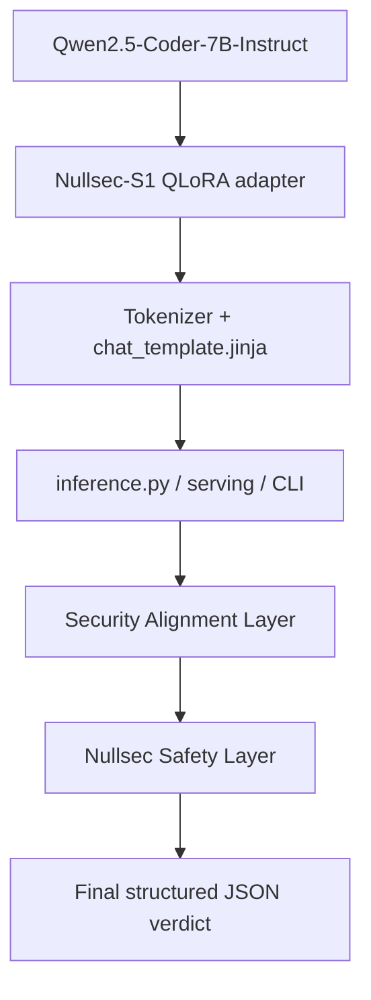

# Nullsec S1 — System Overview

Nullsec S1 is a **security-native LLM system** for AI-generated application
security. This document is the technical map of the whole system: the problem it
targets, how the pieces fit together, and where the honest boundaries are.

The reference implementation ships as the `nullsec1` package and CLI; the model
release identity is `Nullsec-1.0`.

---

## 1. Problem

AI tooling now writes a large and growing share of application code. Generation
is no longer the bottleneck — **trust is**. Generated code frequently ships with
the same recurring failures: missing auth, exposed secrets, unsafe admin routes,
absent rate limits, insecure uploads, unbounded wallet approvals,
over-permissioned MCP tools, prompt-injection-to-tool-execution paths, and
configuration exposure.

A general-purpose model can describe these issues in prose, but its answer is:

- **unstructured** — hard to gate a CI pipeline on free text;
- **non-deterministic** — the same code can get different verdicts;
- **manipulable** — a prompt injection in the reviewed code can talk the model
  into declaring unsafe code safe.

Nullsec S1 exists to convert "an opinion about code" into "a structured,
schema-checked, deterministically-enforced verdict about whether code is safe to
ship."

---

## 2. Architecture

Nullsec S1 is a pipeline with a clear split of responsibility:

- **Proposal (learned).** A security-tuned model reads code and proposes a
  verdict: findings, severities, exploit scenarios, secure patches, and a
  self-assessed production-readiness.
- **Enforcement (deterministic).** Two non-learned layers align that proposal to
  a contract and then decide, by fixed rules, whether the code may be called
  production-ready.

```
AI-generated app / repo / PR / MCP tool / wallet flow
        │
        ▼
Nullsec S1 reasoning pipeline      (nullsec/core/engine.py)
        │  raw output
        ▼
Security Alignment Layer           (nullsec/safety/alignment.py)
        │  structurally-valid, normalized verdict
        ▼
Nullsec Safety Layer               (nullsec/safety/enforcement.py)
        │  production_ready recomputed deterministically
        ▼
enforced verdict  ->  patch · report · CI gate · API response
```

The two deterministic layers run identically whether the system is invoked via
the server, the CLI, the benchmark suite, or the training-data builder. **There
is exactly one enforcement path.**

## 2.1 Model artifacts

RC2/v1.1 is distributed as GitHub Release `v1.0.0-rc25`, not as committed source
files. The release artifact contains the trained adapter and reports; the source
repository contains the training pipeline, corpus, benchmark harness,
documentation, and validation gates. A source-only checkout can run the data and
safety checks, but artifact-gated trained/benchmarked claims require unpacking
the release assets locally.



The adapter is a PEFT/QLoRA adapter; the RC2/v1.1 release artifact includes
`adapter_model.safetensors`, `adapter_config.json`, tokenizer files, and
`chat_template.jinja`. There is no custom hidden reasoning-token loop; the model
returns a final structured JSON audit.

---

## 3. Reasoning pipeline

`nullsec/core/engine.py :: NullsecPipeline` is the path from code to a trusted
verdict:

1. `build_analyze_messages()` frames the input with the canonical strict-reviewer
   system instruction (`nullsec/core/prompts.py`) plus the code under review.
2. The model generates raw text (expected to be a JSON verdict). Heavy
   dependencies (torch/transformers/peft) load lazily, so the deterministic
   layers, CLI help, and tests run with no GPU stack installed.
3. `finalize()` hands the raw text to the deterministic stages.

Generation is temperature 0 by default for reproducibility, and a streaming path
(`generate_stream`) backs the server's SSE endpoint.

---

## 4. Structured verdicts

The output contract is a single JSON object defined by
[`../data/schemas/verdict.schema.json`](../data/schemas/verdict.schema.json):

- `risk_score` (0–100), `production_ready` (bool — **advisory** from the model),
  `severity`, `confidence`
- `reasoning_summary`, optional `exploit_scenario`, `affected_files`
- `checks_performed` — an explicit status (`pass | fail | not_applicable |
  not_checked`) for **each of the 8 required dimensions**
- `findings[]` — each with a taxonomy `category`, `severity`, `confidence`,
  `file`, `line`, `description`, `exploit_scenario`, `recommended_fix`, and a
  `secure_patch`

The schema is the contract between the learned and deterministic halves of the
system. The 8 required check dimensions are:

`auth · secrets · input_validation · rate_limits · permissions · dangerous_exec · dependency_risk · environment_exposure`

The 16-category taxonomy (`taxonomy/taxonomy.json`) maps each vulnerability class
to exactly one primary dimension, with default severities and CWE references.

---

## 5. Safety Layer

The deterministic enforcement is what makes this a *system* rather than a model
that emits opinions. The model's `production_ready` is replaced by a computed
value. `production_ready: true` is denied if **any** rule fires:

| Rule | Denies `production_ready` when… |
|------|---------------------------------|
| R1 | a required dimension is `not_checked` |
| R2 | a required dimension is `fail` |
| R3 | any finding is HIGH or CRITICAL |
| R4 | `risk_score` exceeds the production threshold (default 20) |
| R5 | a finding contradicts a dimension reported as `pass` |
| R6 | overall severity is HIGH or CRITICAL |

The layer also raises (never lowers) severity and `risk_score` to match the worst
finding. Full detail, including the prompt-injection resistance argument, is in
[`SECURITY_ALIGNMENT_LAYER.md`](SECURITY_ALIGNMENT_LAYER.md).

---

## 6. Corpus

`corpus/` is the single source of truth for training data. The current curated
corpus is **1,741 examples** (1,304 hand-authored + 437 curated-ingested),
spanning all 16 categories with **≥ 60 curated examples each** and **100% Safety
Layer consistency**. Provenance is tracked explicitly (`hand_authored`,
`curated_ingested`, `synthetic_variant`), and synthetic data never counts toward
curated thresholds. The schema, provenance rules, and curation workflow are in
[`CORPUS.md`](CORPUS.md).

---

## 7. Training pipeline

`training/` turns the corpus into a fine-tuned adapter:

- `prepare_dataset.py` — builds chat-formatted train/eval JSONL, validating every
  record through the same alignment + safety layers used at serving time.
- `release_threshold.py` — blocks a v1.0 run unless the corpus is genuinely ready
  (≥ 500 curated, ≥ 25/category, ≥ 100 eval, 100% consistency).
- `preflight_train.py` — fails fast if there is no GPU, missing deps, no dataset,
  or an unready corpus (exits `2` specifically when no CUDA GPU is present).
- `train_qlora.py` — 4-bit NF4 QLoRA SFT with completion-only loss on the verdict
  tokens, single-24GB-GPU defaults in `config.yaml`.
- `merge_adapter.py` — optional merge into dense weights for serving.

Base model: `Qwen/Qwen2.5-Coder-7B-Instruct` (Apache 2.0); 14B is a config-only
swap. See [`../GPU_QUICKSTART.md`](../GPU_QUICKSTART.md).

---

## 8. Benchmark pipeline

`benchmarks/` measures the model once real outputs exist. Metric families:
detection accuracy, false-safe rate, hallucination rate, OWASP coverage, patch
correctness (structural), and a secure-generation score. Runs are either
`--mode model` (live GPU) or `--mode replay` (captured real outputs, marked
replay-only). A case with no output is a **real miss**, never a synthetic pass.
No precomputed numbers ship with the repo. Adversarial Safety Layer probes
(`benchmarks/safety_probes.py`) are deterministic and run with no GPU.

---

## 9. Release gate

`scripts/release_candidate.py` assembles `releases/nullsec-1.0/` from real
artifacts only. It aborts (writing nothing) if the adapter is missing, the model
fails to load, no outputs are produced, any report section is empty, or any
Safety Layer probe is bypassed. `scripts/validate_claims.py` then gates which
public claims the docs may state, scanning `README.md` and `RELEASE_SUMMARY.md`
and failing CI on any unsubstantiated assertion. This is the honesty backbone of
the project — see [`NON_CLAIMS.md`](NON_CLAIMS.md) and
[`../RELEASE_TRAINING.md`](../RELEASE_TRAINING.md).

---

## 10. Current limitations

- **Release-candidate scope.** RC2/v1.1 was evaluated on the included 111-case
  benchmark suite and passed the Nullsec internal release gate there. Performance
  on arbitrary real-world systems can differ.
- **Corpus depth.** 1,741 curated examples is a strong RC2/v1.1 corpus, but
  recall on real-world variety grows with broader coverage.
- **Patch verification is structural.** The benchmark checks that patches are
  well-formed and do not reintroduce known-insecure patterns; compile/run/test
  verification is future work.
- **Not a replacement for human review.** A clean verdict reduces risk; it does
  not prove the absence of vulnerabilities. Use Nullsec S1 as an additional,
  security-native layer alongside SAST/DAST and human review.
